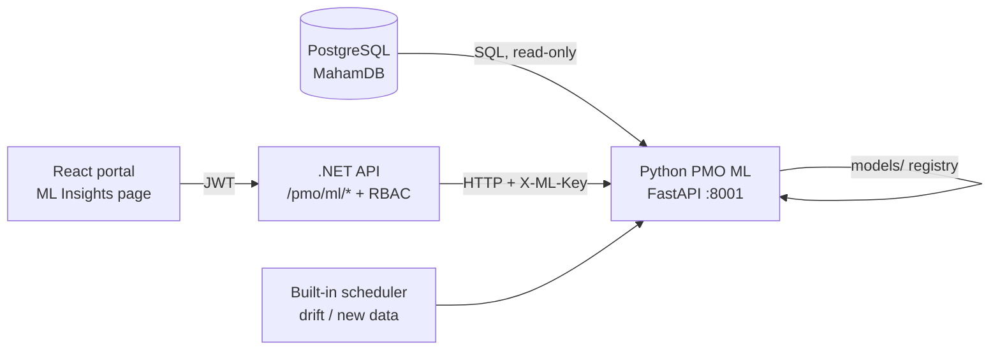

# PMO ML — Machine Learning for the PMO Portal

**English** · [العربية](#العربية)

A complete, from-scratch machine-learning project (Python + scikit-learn) that learns from the PMO Portal's own
PostgreSQL database and serves predictions back into the portal through the .NET API. It follows the ten
classic steps of the ML lifecycle, and every step is a module you can read, run and change.

| # | Model | Task type | What the portal shows |
|---|---|---|---|
| 1 | **Task delay risk** | Binary classification | Delay probability for every open task |
| 2 | **Risk severity** | Multiclass classification (TF-IDF text) | "Suggest severity" while a risk is typed |
| 3 | **Monthly spend forecast** | Time-aware regression | Next month's spend per project vs plan |
| 4 | **Cost anomaly detection** | Unsupervised outlier detection | Expenses that deserve a finance review |
| 5 | **Portfolio segmentation** | Clustering (KMeans) | Segment tag per project (e.g. *At risk*) |



## Quick start (Windows, 5 minutes)

```bash
powershell -ExecutionPolicy Bypass -File ml\scripts\setup.ps1
```

```bash
powershell -ExecutionPolicy Bypass -File ml\scripts\run_pipeline.ps1
```

```bash
ml\.venv\Scripts\python -m pmo_ml serve
```

Then open <http://localhost:8001/docs> (interactive API), start the .NET API and the frontend as usual, sign in and
open **ML Insights** in the sidebar.

The database connection is **read at runtime from** `backend/ZR.Admin.WebApi/appsettings.json → dbConfigs[0].Conn`,
so the ML service always uses the same database as the portal and no password is copied into this folder.
Override with `PMO_DB_CONN` (Npgsql style) or `DATABASE_URL` (postgres://…).

## Tutorials — one per lifecycle step

| File | Step |
|---|---|
| [00_START_HERE](docs/00_START_HERE.md) | Architecture, setup, glossary, how to read the code |
| [00_MODIFICATIONS](docs/00_MODIFICATIONS.md) | Every file added or changed in the repository for ML |
| [01_PROBLEM_DEFINITION](docs/01_PROBLEM_DEFINITION.md) | Objectives, task types, labels, success metrics |
| [02_DATA_COLLECTION](docs/02_DATA_COLLECTION.md) | Tables, SQL, lineage snapshots, ethics & privacy |
| [03_DATA_CLEANING](docs/03_DATA_CLEANING.md) | Duplicates, labels, types, business rules, imputation |
| [04_EDA](docs/04_EDA.md) | Statistics, histograms, heatmaps, boxplots, findings |
| [05_FEATURE_ENGINEERING](docs/05_FEATURE_ENGINEERING.md) | Features per model and the no-leakage rule |
| [06_MODEL_SELECTION](docs/06_MODEL_SELECTION.md) | Candidate algorithms and why each is there |
| [07_MODEL_TRAINING](docs/07_MODEL_TRAINING.md) | Splits, cross-validation, tuning, refit |
| [08_MODEL_EVALUATION](docs/08_MODEL_EVALUATION.md) | Metrics, baselines, today's results, explainability |
| [09_DEPLOYMENT](docs/09_DEPLOYMENT.md) | FastAPI service, .NET bridge, Docker, Render |
| [10_MONITORING_AND_AUTOMATION](docs/10_MONITORING_AND_AUTOMATION.md) | Drift (PSI), live accuracy, auto-retrain |
| [11_UI_AND_API_REFERENCE](docs/11_UI_AND_API_REFERENCE.md) | Every endpoint, the portal page, permissions |
| [12_CUSTOMIZATION](docs/12_CUSTOMIZATION.md) | Add a model, a feature or an algorithm (tutorial) |
| [13_RUN_AND_DEBUG](docs/13_RUN_AND_DEBUG.md) | Run the whole stack step by step, and debug the ML |

## Commands

| Command | What it does |
|---|---|
| `python -m pmo_ml train` | Full pipeline: collect → clean → EDA → features → select → train → evaluate → register |
| `python -m pmo_ml train --problem task_delay --source csv` | One model, trained on the CSV seed |
| `python -m pmo_ml eda` | EDA charts + `reports/eda/EDA.md` |
| `python -m pmo_ml evaluate` | Metrics of the models being served |
| `python -m pmo_ml predict task_delay --lang ar` | Live predictions in the terminal |
| `python -m pmo_ml monitor` | Drift / new data / live accuracy (exit code 3 = retrain) |
| `python -m pmo_ml promote task_delay 20261025-025527` | Roll back to an older model version |
| `python -m pmo_ml serve` | Start the REST API on port 8001 |
| `python -m pytest` | 23 tests (run inside `ml/`) |
| `scripts\start_all.ps1` / `scripts\check_stack.ps1` | Start the whole stack / check every layer |

## Honest limits

The PMO database is small (tens of rows per table), so every metric is reported next to a Dummy baseline and with
its evaluation method. Task delay and spend forecast clearly beat their baselines today; risk severity is weak
(24 risks) and is shown as a *suggestion*, not a verdict. Metrics improve automatically as the portal collects
more data, because the scheduler retrains when enough new rows arrive.

---

<div dir="rtl">

## العربية

# PMO ML — التعلّم الآلي لبوابة مكتب إدارة المشاريع

مشروع تعلّم آلي متكامل مبني من الصفر (Python و scikit-learn) يتعلّم من قاعدة بيانات PostgreSQL الخاصة بالبوابة نفسها،
ثم يعيد التنبؤات إلى البوابة عبر واجهة ‎.NET البرمجية. يتبع المشروع خطوات دورة حياة التعلّم الآلي العشر، وكل خطوة
وحدة برمجية مستقلة يمكنك قراءتها وتشغيلها وتعديلها.

| # | النموذج | نوع المهمة | ما يظهر في البوابة |
|---|---|---|---|
| 1 | **خطر تأخر المهمة** | تصنيف ثنائي | احتمال التأخر لكل مهمة مفتوحة |
| 2 | **شدة الخطر** | تصنيف متعدد الفئات (نص TF-IDF) | «اقترح الشدة» أثناء كتابة الخطر |
| 3 | **توقع الإنفاق الشهري** | انحدار زمني | إنفاق الشهر القادم لكل مشروع مقابل الخطة |
| 4 | **كشف التكاليف غير الاعتيادية** | كشف القيم الشاذة (غير موجّه) | مصروفات تستحق مراجعة مالية |
| 5 | **تقسيم المحفظة** | تجميع (KMeans) | وسم الشريحة لكل مشروع (مثل «معرّض للخطر») |

## البدء السريع (ويندوز، 5 دقائق)

1. ‏`ml\scripts\setup.ps1` — إنشاء البيئة الافتراضية وتثبيت المكتبات.
2. ‏`ml\scripts\run_pipeline.ps1` — تشغيل خط المعالجة كاملاً وتدريب النماذج الخمسة.
3. ‏`ml\.venv\Scripts\python -m pmo_ml serve` — تشغيل خدمة الواجهة البرمجية على المنفذ 8001.

ثم افتح <http://localhost:8001/docs>، وشغّل واجهة ‎.NET والواجهة الأمامية كالمعتاد، وسجّل الدخول وافتح
**رؤى التعلّم الآلي** من القائمة الجانبية.

يُقرأ اتصال قاعدة البيانات **أثناء التشغيل** من الملف
`backend/ZR.Admin.WebApi/appsettings.json → dbConfigs[0].Conn`، لذلك تستخدم الخدمة دائماً قاعدة البيانات نفسها
ولا تُنسخ أي كلمة مرور إلى هذا المجلد. يمكن التجاوز بالمتغيّر `PMO_DB_CONN` أو `DATABASE_URL`.

## الدروس — درس لكل خطوة

الملفات من `00` إلى `13` في مجلد [docs](docs/00_START_HERE.md)، وكل ملف مكتوب بالإنجليزية ثم بالعربية.
الملف [00_MODIFICATIONS](docs/00_MODIFICATIONS.md) يسرد كل ملف أُضيف أو عُدّل في المستودع.

## حدود واقعية

قاعدة بيانات البوابة صغيرة (عشرات الصفوف في كل جدول)، لذلك يُعرض كل مقياس بجانب نموذج أساس بسيط (Dummy) مع طريقة
التقييم. نموذجا تأخر المهام وتوقع الإنفاق يتفوقان بوضوح على خط الأساس اليوم؛ أما شدة الخطر فضعيف (24 خطراً فقط)
ويُعرض كـ«اقتراح» لا كحكم نهائي. تتحسن المقاييس تلقائياً مع ازدياد البيانات لأن المجدول يعيد التدريب عند وصول صفوف جديدة كافية.

</div>
