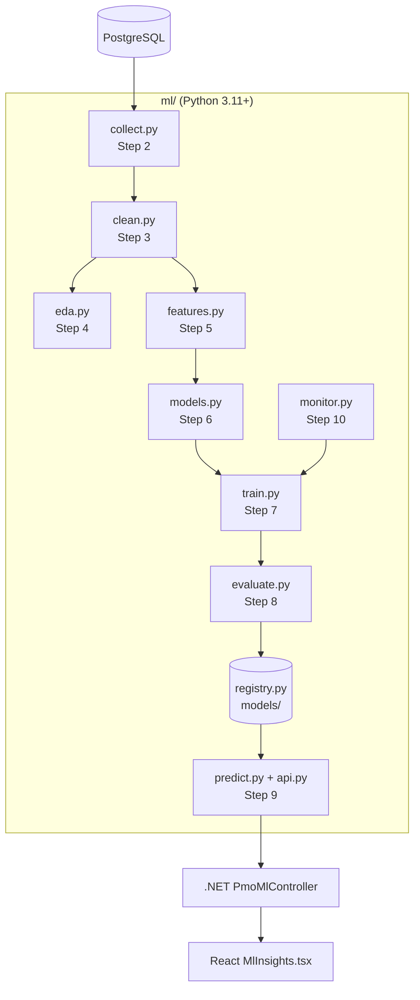

# 00 · Start here

**English** · [العربية](#العربية)

## What you are looking at

`ml/` is a self-contained Python project. It reads the PMO tables from PostgreSQL, trains five scikit-learn models,
stores them in a versioned registry and serves predictions over a REST API. The .NET API forwards the portal's
requests to it (with RBAC), and the React portal shows the results on the **ML Insights** page.



## Folder map

| Path | Purpose |
|---|---|
| `config/config.yaml` | Every setting (data source, paths, CV folds, thresholds, API port, scheduler) |
| `src/pmo_ml/problems.py` | **Step 1** — the five problem definitions (bilingual) |
| `src/pmo_ml/db.py`, `collect.py` | **Step 2** — connection from `appsettings.json`, SQL, snapshots |
| `src/pmo_ml/clean.py` | **Step 3** — duplicates, labels, types, business rules |
| `src/pmo_ml/eda.py` | **Step 4** — statistics, charts, findings report |
| `src/pmo_ml/features.py` | **Step 5** — one feature builder per problem |
| `src/pmo_ml/models.py` | **Step 6** — preprocessing pipelines + candidate algorithms |
| `src/pmo_ml/train.py` | **Step 7** — split, cross-validate, tune, select, refit, save |
| `src/pmo_ml/evaluate.py` | **Step 8** — metrics, plots, permutation importance |
| `src/pmo_ml/api.py`, `predict.py` | **Step 9** — FastAPI service and live inference |
| `src/pmo_ml/monitor.py` | **Step 10** — drift (PSI), live accuracy, retrain decision |
| `src/pmo_ml/registry.py` | Versioned model store + `current.json` pointer |
| `src/pmo_ml/pipeline.py`, `cli.py` | Orchestration and the `python -m pmo_ml …` commands |
| `src/pmo_ml/i18n.py` | English / Arabic labels returned by the API |
| `tests/` | 23 pytest tests (CSV seed, isolated temp folders) |
| `scripts/` | `setup.ps1`, `run_pipeline.ps1`, `register_retrain_task.ps1` |
| `models/`, `reports/`, `data/raw/` | Generated at runtime, git-ignored |

## Setup

Requirements: Python 3.11+ (tested on 3.13), the PMO PostgreSQL running (the same one the .NET API uses).

```bash
powershell -ExecutionPolicy Bypass -File ml\scripts\setup.ps1
```

Manual equivalent: `python -m venv ml\.venv`, then `ml\.venv\Scripts\pip install -r ml\requirements.txt` and
`pip install -e ml`.

Check the connection and train everything:

```bash
ml\.venv\Scripts\python -m pmo_ml train
```

No database at hand? Train on the synthetic seed shipped in `data/csv`:

```bash
ml\.venv\Scripts\python -m pmo_ml train --source csv
```

## How to read the code

Follow one model end to end, for example **task delay**: `problems.py` (definition) →
`features.task_delay_dataset` (features + label) → `models.classification_candidates` (algorithms) →
`train.train_classification` (selection) → `predict.task_delay` (live scoring) → `api.predict_task_delay`
(endpoint) → `PmoMlController.TaskDelay` (.NET) → `MlInsights.tsx › DelayTab` (UI).

## Glossary

| Term | Meaning |
|---|---|
| Label / target | What the model predicts (e.g. *late* = 1) |
| Feature | An input column the model learns from |
| Baseline | A trivial model (always the majority class, last month's value…). A real model must beat it |
| Cross-validation (CV) | Train/test several times on different folds to get a stable score |
| Hold-out | Rows kept aside and used only once, for the final score |
| Leakage | A feature that secretly contains the answer — gives great but fake scores |
| PSI | Population Stability Index — how much a feature's distribution moved since training |
| Registry | Folder of saved model versions; `current.json` says which one is served |

---

<div dir="rtl">

## العربية

## ما الذي أمامك

المجلد `ml/` مشروع Python مستقل. يقرأ جداول PMO من PostgreSQL، ويدرّب خمسة نماذج scikit-learn، ويحفظها في سجل
نماذج مُرقّم الإصدارات، ويقدّم التنبؤات عبر واجهة REST. تقوم واجهة ‎.NET بتمرير طلبات البوابة إليه (مع التحقق من
الصلاحيات)، وتعرض بوابة React النتائج في صفحة **رؤى التعلّم الآلي**.

## خريطة المجلدات

| المسار | الغرض |
|---|---|
| `config/config.yaml` | كل الإعدادات (مصدر البيانات، المسارات، عدد طيّات التحقق، العتبات، المنفذ، المجدول) |
| `problems.py` | **الخطوة 1** — تعريف المشكلات الخمس (بلغتين) |
| `db.py`، `collect.py` | **الخطوة 2** — الاتصال من `appsettings.json`، استعلامات SQL، اللقطات |
| `clean.py` | **الخطوة 3** — التكرارات، توحيد القيم، الأنواع، قواعد العمل |
| `eda.py` | **الخطوة 4** — الإحصاءات، المخططات، تقرير النتائج |
| `features.py` | **الخطوة 5** — مُنشئ خصائص لكل مشكلة |
| `models.py` | **الخطوة 6** — خطوط المعالجة والخوارزميات المرشحة |
| `train.py` | **الخطوة 7** — التقسيم، التحقق المتقاطع، الضبط، الاختيار، إعادة التدريب، الحفظ |
| `evaluate.py` | **الخطوة 8** — المقاييس، المخططات، أهمية الخصائص |
| `api.py`، `predict.py` | **الخطوة 9** — خدمة FastAPI والتنبؤ المباشر |
| `monitor.py` | **الخطوة 10** — الانحراف (PSI)، الدقة الفعلية، قرار إعادة التدريب |
| `tests/` | 23 اختباراً آلياً |
| `scripts/` | سكربتات الإعداد والتشغيل والجدولة |

## الإعداد

المتطلبات: Python 3.11 أو أحدث، وقاعدة PostgreSQL الخاصة بالبوابة تعمل.
شغّل `ml\scripts\setup.ps1` مرة واحدة، ثم `ml\.venv\Scripts\python -m pmo_ml train` للتدريب.
بدون قاعدة بيانات؟ استخدم البيانات التجريبية: `python -m pmo_ml train --source csv`.

## كيف تقرأ الشيفرة

تتبّع نموذجاً واحداً من البداية للنهاية، مثل **تأخر المهام**: التعريف في `problems.py` ← الخصائص في
`features.task_delay_dataset` ← الخوارزميات في `models.classification_candidates` ← الاختيار في
`train.train_classification` ← التنبؤ في `predict.task_delay` ← نقطة النهاية في `api.py` ← وحدة التحكم
`PmoMlController` في ‎.NET ← تبويب `DelayTab` في `MlInsights.tsx`.

## مسرد المصطلحات

| المصطلح | المعنى |
|---|---|
| التسمية / الهدف | ما يتنبأ به النموذج (مثلاً «متأخرة» = 1) |
| الخاصية | عمود إدخال يتعلم منه النموذج |
| خط الأساس | نموذج بسيط جداً (الفئة الأكثر تكراراً، قيمة الشهر الماضي…) ويجب أن يتفوق عليه النموذج الحقيقي |
| التحقق المتقاطع | تدريب واختبار عدة مرات على أجزاء مختلفة للحصول على نتيجة مستقرة |
| بيانات الاختبار المحجوزة | صفوف تُستخدم مرة واحدة فقط للتقييم النهائي |
| التسرّب | خاصية تحتوي الجواب ضمنياً، فتعطي نتائج ممتازة لكنها زائفة |
| PSI | مؤشر استقرار التوزيع — مقدار تغيّر توزيع الخاصية منذ التدريب |
| سجل النماذج | مجلد إصدارات النماذج المحفوظة؛ والملف `current.json` يحدد الإصدار المستخدم |

</div>
