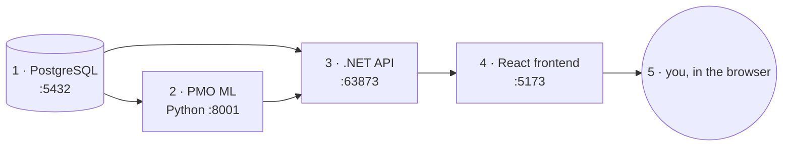

# 13 · Run everything, step by step — and debug the ML

**English** · [العربية](#العربية)

The local stack is four processes, started in this order (each one depends on the previous):



> Run all commands from the repository folder that contains `ml/` — today that is the `feat/pmo-ml` branch
> (`C:\Users\Abdulqader Al-Shawea\Downloads\applayied-ml`) until it is merged into `main`.

## One command (after the first-time setup)

```bash
powershell -ExecutionPolicy Bypass -File ml\scripts\start_all.ps1
```

opens one window per service (ML, API, frontend) in the right order. Add `-Train` to retrain the models first.
Then check everything:

```bash
powershell -ExecutionPolicy Bypass -File ml\scripts\check_stack.ps1
```

Expected: six `[ OK ]` lines (PostgreSQL, ML → database, 5 of 5 models, ML service, .NET API, frontend).

## Step by step

### 0 · Prerequisites (once)

| Tool | Check | Version |
|---|---|---|
| .NET SDK | `dotnet --version` | 8.x |
| Node.js | `node --version` | 18+ |
| Python | `python --version` | 3.11+ (tested 3.13) |
| PostgreSQL | `Test-NetConnection localhost -Port 5432` | 14+, database `MahamDB` from `dbConfigs[0].Conn` |

Optional: copy your git-ignored `backend\ZR.Admin.WebApi\appsettings.Development.json` (AI keys) from the main
checkout into this folder, so the ✨ AI assistant works too. The ML features do not need it.

### 1 · PostgreSQL

Make sure it is running (Windows *Services* → `postgresql-x64-…` → Start, or start your Docker container). First
run of a brand-new database only: follow *1 — Database & backend* in the root `README.md` (`InitDb` / `PmoSeed`).

### 2 · ML service — terminal 1

First time:

```bash
powershell -ExecutionPolicy Bypass -File ml\scripts\setup.ps1
```

```bash
powershell -ExecutionPolicy Bypass -File ml\scripts\run_pipeline.ps1
```

`run_pipeline` ends with `"status": "ok"` and five models `"trained"` (about one minute). Every time:

```bash
ml\.venv\Scripts\python -m pmo_ml serve
```

Ready when it prints `Uvicorn running on http://0.0.0.0:8001`. Test: <http://localhost:8001/health> and the
interactive API at <http://localhost:8001/docs>.

### 3 · .NET API — terminal 2

```bash
$env:ASPNETCORE_ENVIRONMENT="Development"; $env:ASPNETCORE_URLS="http://localhost:63873"; dotnet run --project backend\ZR.Admin.WebApi
```

Ready when it prints `Now listening on: http://localhost:63873`. On start the seeder logs
`[PMO seed] pmo permissions: … created` the first time it sees the ML permissions.

**Why the environment variables:** `Properties/launchSettings.json` is git-ignored, so a fresh folder has none.
Without `ASPNETCORE_ENVIRONMENT=Development`, .NET runs as *Production* and loads `appsettings.Production.json`
(a remote database and an HTTPS certificate that are not on your machine). Port 63873 is what the frontend's dev
proxy expects (`VITE_API_TARGET`).

### 4 · Frontend — terminal 3

```bash
cd frontend
npm install
npm run dev
```

(`npm install` only the first time.) Ready when Vite prints `Local: http://localhost:5173/`.

### 5 · Use it

Open <http://localhost:5173>, sign in (`pmo.admin` / `123456`, plus the captcha), and open **ML Insights** in the sidebar. Switch EN ⇄ AR from the top bar; the page, numbers and charts mirror to right-to-left.
Contributors (`con.mariam`) see the page without the finance tabs — that is RBAC, not a bug.

### Stop

`Ctrl+C` in each window, in reverse order (frontend, API, ML). If a port stays busy:

```bash
Get-NetTCPConnection -State Listen -LocalPort 8001,63873,5173 | Select-Object LocalPort, OwningProcess
```

then `Stop-Process -Id <OwningProcess>`.

### Other projects in the repository

The presentation decks (`presentation/`, `assignment2/`) are static sites: open their `index.html`, or serve the
folder with `python -m http.server 8080` and browse <http://localhost:8080>. Power BI: see `powerbi/README.md`.

---

## Debugging the ML

### Which layer is failing?

| Symptom | Layer | First check |
|---|---|---|
| `check_stack` says *ML → database FAIL* | database / connection | `dbConfigs[0].Conn`, PostgreSQL running |
| page shows "ML service offline" | ML service | terminal 1 still running? <http://localhost:8001/health> |
| page shows "ML insights are unavailable — ML service unreachable" | .NET → ML | `ML:BaseUrl` in `appsettings.json`; API log lines starting with `[PMO-ML]` |
| "… HTTP 401" from the ML service | shared key | `ML__ApiKey` (API) must equal `PMO_ML_API_KEY` (ML) |
| "Model not trained yet" | registry | `python -m pmo_ml train`; `models/<model>/current.json` exists? |
| empty delay table | data | no open task with a future due date at the as-of date — check `data.as_of_date` |
| numbers look wrong | features / model | debug the feature builder (below) |
| 403 on spend / anomalies | RBAC | the role lacks `pmo:finance:list` (by design) |

### 1 · Debug in VS Code (breakpoints)

1. **File → Open Folder → `ml`** (the folder that contains `.vscode/launch.json`).
2. **Ctrl+Shift+P → Python: Select Interpreter →** `ml\.venv\Scripts\python.exe`.
3. Open the *Run and Debug* panel and pick a configuration:

| Configuration | Use it to |
|---|---|
| **ML: serve API (debug)** | set a breakpoint in `predict.py` (e.g. `task_delay`), then call the endpoint from <http://localhost:8001/docs> — execution stops on your line |
| **ML: train one model** | step through `features.py` → `train.py` for one model (asks which); also steps into scikit-learn |
| **ML: train on CSV seed** | reproduce a problem without the database |
| **ML: predict (terminal)** | inspect live predictions without the API |
| **ML: monitor** | inspect drift / PSI calculations |
| **ML: pytest (all)** | break inside a failing test |

Stop the normal `pmo_ml serve` window first: the debug server uses the same port 8001.

### 2 · Debug without an IDE (`pdb`)

Put `breakpoint()` on the line you want, e.g. in `features.task_delay_dataset`, and run:

```bash
ml\.venv\Scripts\python -m pmo_ml train --problem task_delay --no-eda
```

At the `(Pdb)` prompt: `p feats.head()` print · `p feats.isna().sum()` · `n` next line · `s` step into · `c`
continue · `q` quit. Remove the `breakpoint()` afterwards.

### 3 · Inspect the data and a model interactively

```bash
ml\.venv\Scripts\python
```

```python
from pmo_ml.config import load_settings
from pmo_ml.collect import collect
from pmo_ml.clean import clean
from pmo_ml.features import BUILDERS
from pmo_ml import registry

s = load_settings()
frames, report = clean(collect(s))            # step 2 + 3
report["tasks"]                               # rows, duplicates, missing values
ds = BUILDERS["task_delay"](frames, s.as_of)  # step 5
ds.X.describe(); ds.y.value_counts()          # features and label
model, meta = registry.load(s, "task_delay")  # the model being served
meta["best_model"], meta["metrics"]
proba = model.predict_proba(ds.extra["predict_X"])[:, 1]
list(zip(ds.extra["predict_rows"]["title"], proba.round(2)))[:5]
```

### 4 · Read the artifacts every run leaves behind

| File | Tells you |
|---|---|
| `models/<model>/current.json` | which version is served |
| `models/<model>/<version>/metadata.json` | every candidate's CV score **and errors**, winner, metrics, baseline, features, drift profile |
| `reports/models/<model>/<version>/*.png` | comparison, confusion matrix, ROC, residuals, importance |
| `reports/eda/EDA.md` + `reports/eda/<model>/summary.json` | data shape, missing values, correlations, findings |
| `reports/training_history.jsonl` | every training run, its trigger and result |
| `reports/monitoring/predictions.jsonl` | logged delay predictions used for live accuracy |
| `data/raw/<timestamp>/*.csv` | the exact data a run saw — retrain on it to reproduce a model |

A candidate that failed shows `"error": "…"` in `metadata.json → candidates` (for example k-NN asking for more
neighbours than there are rows); the run continues with the others.

### 5 · More logging from the API

```bash
cd ml
.venv\Scripts\python -m uvicorn pmo_ml.api:app --port 8001 --log-level debug --reload
```

`--reload` restarts the service whenever you save a `.py` file.

### 6 · Tests as a debugging tool

```bash
cd ml
.venv\Scripts\python -m pytest -x -k features --pdb
```

`-x` stops at the first failure, `-k` filters by name, `--pdb` opens the debugger at the failing line. The .NET
side has its own tests: `dotnet test backend\ZR.Pmo.Tests` (6 of them cover the ML bridge).

### 7 · Debug the .NET bridge and the page

* API window: lines starting with `[PMO-ML]` show the URL called and the ML service's error.
* Browser **F12 → Network**, filter `pmo/ml`: open a request and read the **Response** — when something fails it
  is `{ "available": false, "message": "…" }` with the reason.
* To call the API by hand, copy the `Authorization: Bearer …` header of any request from the Network tab and use it
  with `curl` or Postman against `http://localhost:63873/pmo/ml/...`.

---

<div dir="rtl">

## العربية

## تشغيل كل شيء خطوة بخطوة — وتصحيح أخطاء التعلّم الآلي

تتكوّن البيئة المحلية من أربع عمليات تُشغَّل بهذا الترتيب: **‏1) PostgreSQL ‏(5432)** ← **‏2) خدمة التعلّم الآلي (8001)** ←
**‏3) واجهة ‎.NET ‏(63873)** ← **‏4) الواجهة الأمامية React ‏(5173)** ← ثم المتصفح.

> شغّل كل الأوامر من مجلد المستودع الذي يحتوي `ml/` (حالياً الفرع `feat/pmo-ml` في المجلد `applayied-ml`) إلى أن يُدمج في `main`.

### أمر واحد (بعد الإعداد الأول)

- ‏`ml\scripts\start_all.ps1` يفتح نافذة لكل خدمة بالترتيب الصحيح (أضف `-Train` لإعادة التدريب أولاً).
- ‏`ml\scripts\check_stack.ps1` يفحص الكل؛ المتوقع ستة أسطر `[ OK ]`.

### خطوة بخطوة

0. **المتطلبات (مرة واحدة):** ‎.NET 8، و Node.js 18 أو أحدث، و Python 3.11 أو أحدث، و PostgreSQL يعمل مع قاعدة `MahamDB`.
   اختيارياً انسخ الملف `appsettings.Development.json` (مفاتيح الذكاء الاصطناعي) من النسخة الرئيسية إلى هذا المجلد.
1. **PostgreSQL:** تأكد أنه يعمل (من «الخدمات» في ويندوز أو حاوية Docker).
2. **خدمة التعلّم الآلي — الطرفية 1:** في المرة الأولى `setup.ps1` ثم `run_pipeline.ps1` (حوالي دقيقة، وينتهي بـ
   `"status": "ok"`)، وفي كل مرة `ml\.venv\Scripts\python -m pmo_ml serve`. تكون جاهزة عند ظهور
   `Uvicorn running on http://0.0.0.0:8001`.
3. **واجهة ‎.NET — الطرفية 2:** اضبط `ASPNETCORE_ENVIRONMENT=Development` و `ASPNETCORE_URLS=http://localhost:63873`
   ثم `dotnet run --project backend\ZR.Admin.WebApi`. **مهم:** بدون بيئة Development تعمل الواجهة كبيئة إنتاج وتحمّل
   `appsettings.Production.json` (قاعدة بيانات بعيدة وشهادة HTTPS غير موجودة على جهازك). تكون جاهزة عند ظهور
   `Now listening on: http://localhost:63873`.
4. **الواجهة الأمامية — الطرفية 3:** ‏`cd frontend` ثم `npm install` (أول مرة فقط) ثم `npm run dev`.
5. **الاستخدام:** افتح `http://localhost:5173` وسجّل الدخول (`pmo.admin` / `123456` مع رمز التحقق)، ثم افتح
   **رؤى التعلّم الآلي** من القائمة. بدّل بين العربية والإنجليزية من الشريط العلوي.

**الإيقاف:** ‏`Ctrl+C` في كل نافذة بالترتيب العكسي. وإن بقي منفذ مشغولاً استخدم `Get-NetTCPConnection` ثم `Stop-Process`.

**مشاريع أخرى في المستودع:** العروض التقديمية مواقع ثابتة (افتح `index.html` أو `python -m http.server 8080`)، و
Power BI موضّح في `powerbi/README.md`.

## تصحيح أخطاء التعلّم الآلي

**أي طبقة تفشل؟**

| العَرَض | الطبقة | أول ما تفحصه |
|---|---|---|
| فشل «ML → database» | الاتصال بقاعدة البيانات | ‏`dbConfigs[0].Conn` وتشغيل PostgreSQL |
| «خدمة التعلّم الآلي غير متصلة» | خدمة Python | هل الطرفية 1 تعمل؟ و `http://localhost:8001/health` |
| «غير متاحة — unreachable» | الربط بين ‎.NET والخدمة | ‏`ML:BaseUrl` وأسطر `[PMO-ML]` في سجل الواجهة |
| ‏HTTP 401 من الخدمة | المفتاح المشترك | تطابق `ML__ApiKey` مع `PMO_ML_API_KEY` |
| «النموذج غير مدرّب بعد» | سجل النماذج | ‏`python -m pmo_ml train` |
| جدول التأخر فارغ | البيانات | لا توجد مهام مفتوحة بتاريخ استحقاق مستقبلي |
| أرقام غير منطقية | الخصائص أو النموذج | صحّح مُنشئ الخصائص (أدناه) |
| ‏403 على الإنفاق أو التكاليف | الصلاحيات | الدور لا يملك `pmo:finance:list` (مقصود) |

**1) في VS Code بنقاط التوقف:** افتح المجلد `ml`، واختر المفسّر `ml\.venv\Scripts\python.exe`، ثم من لوحة التشغيل
والتصحيح اختر أحد الإعدادات الجاهزة: تشغيل الخدمة للتصحيح (ضع نقطة توقف في `predict.py` ثم استدعِ النقطة من
`/docs`)، أو تدريب نموذج واحد، أو التدريب على بيانات CSV، أو التنبؤ، أو المراقبة، أو الاختبارات. أوقف نافذة الخدمة
العادية أولاً لأن خادم التصحيح يستخدم المنفذ 8001 نفسه.

**2) بدون محرر:** ضع `breakpoint()` في السطر المطلوب ثم شغّل أمر التدريب، واستخدم في موجّه `(Pdb)` الأوامر:
`p` للطباعة، و `n` للسطر التالي، و `s` للدخول، و `c` للمتابعة، و `q` للخروج.

**3) الفحص التفاعلي:** افتح Python من البيئة الافتراضية وانسخ المقطع الموضّح أعلاه لتحميل البيانات والخصائص والنموذج
وفحص التنبؤات خطوة بخطوة.

**4) الملفات الناتجة عن كل تشغيل:** ‏`current.json` (الإصدار المستخدم)، و `metadata.json` (نتائج كل الخوارزميات
**وأخطاؤها**)، ومخططات التقييم، وتقرير `EDA.md`، وسجل التدريب، وسجل التنبؤات، ولقطة البيانات في `data/raw` لإعادة
إنتاج أي نموذج.

**5) سجلات أكثر تفصيلاً:** شغّل الخدمة بـ `uvicorn … --log-level debug --reload` لإعادة التشغيل تلقائياً عند الحفظ.

**6) الاختبارات كأداة تصحيح:** ‏`pytest -x -k features --pdb` يتوقف عند أول فشل ويفتح المصحّح. ولواجهة ‎.NET:
`dotnet test backend\ZR.Pmo.Tests`.

**7) تصحيح الربط والصفحة:** راقب أسطر `[PMO-ML]` في نافذة الواجهة، وافتح أدوات المطوّر في المتصفح (F12 ← Network)
وصفِّ بـ `pmo/ml` واقرأ الاستجابة: عند الفشل تكون `{ "available": false, "message": "…" }` مع السبب.

</div>
